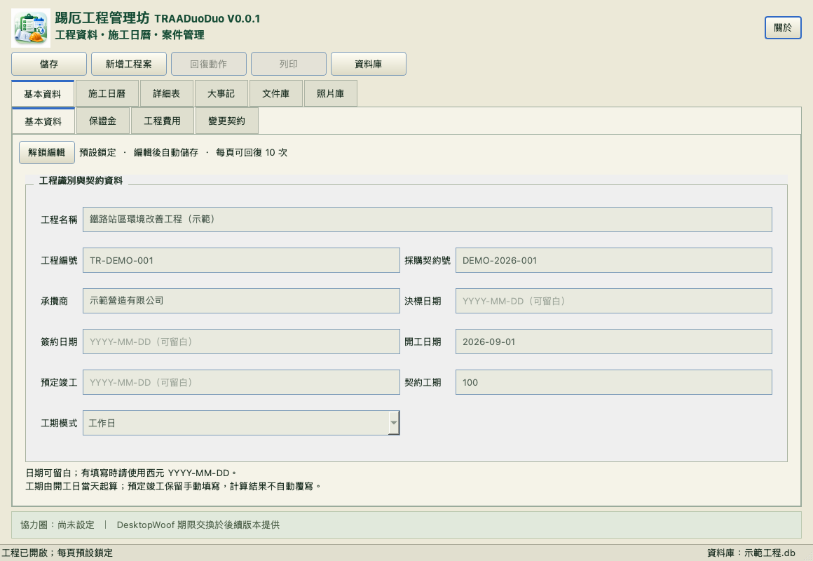
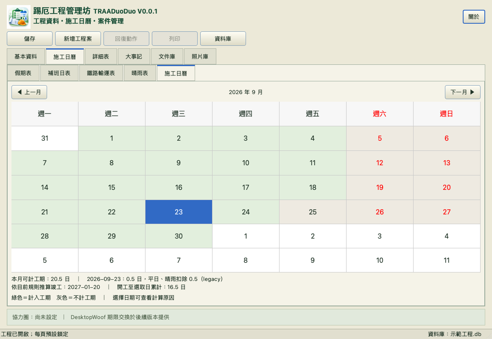

# 踢厄工程管理坊（TRAADuoDuo）

**目前版本：V0.0.1** · Python / PySide6 桌面程式 · GNU GPL v3

TRAADuoDuo 用於管理工程案件基本資料、施工日曆與工程工作。首頁保留最新版本的可執行原始碼；完整版本快照另存於 `history/`。

## 最新版 V0.0.1

- [Python 啟動檔](TRAADuoDuo_V0.0.1.py)
- [Windows 無主控台啟動檔](TRAADuoDuo_V0.0.1.pyw)
- [版本資料夾完整快照](history/V0.0.1/)
- [版本異動紀錄](CHANGELOG.md)

## 功能

- 工程案件使用獨立 SQLite 資料庫，可新增、切換、儲存及備份。
- 基本資料支援分頁鎖定、自動儲存及最多 10 次復原。
- 施工日曆支援假期、補班、鐵路停工、晴雨扣除與工期推算。
- 預留詳細表、大事記、文件庫及照片庫分頁。

## 安裝與啟動

需要 Python 3.11 或更新版本。安裝 PySide6 後，從專案根目錄執行：

```sh
python -m pip install -r requirements.txt
python TRAADuoDuo_V0.0.1.py
```

可用 `--project PATH` 開啟已存在的 TRAADuoDuo 資料庫。新增工程時，請選擇新的 `.db` 路徑；本程式不會覆寫既有資料庫。

Windows 可使用 `start_windows.bat`。macOS 可使用 `start_macos.command`。目前已在 macOS / Python 3.14.5 / PySide6 6.11.1 完成離屏啟動與 UI 測試；Windows 實機、DPI 及 EXE 封裝尚未驗證。本 repository 提供原始碼，不包含安裝程式或預編譯執行檔。

## 畫面





## 版本與檔案

- 根目錄：目前最新版程式、啟動入口、安裝依賴與主要文件。
- `history/Vx.y.z/`：已保留的完整歷史版本快照。
- `docs/`：驗證紀錄、交接說明與畫面預覽。

V0.0.1 尚未包含完整預算計價、文件/照片管理、列印或 DesktopWoof 期限同步功能；相關頁面會明確標示尚未啟用。

## 授權

本專案依 [GNU General Public License v3.0](LICENSE) 授權。
