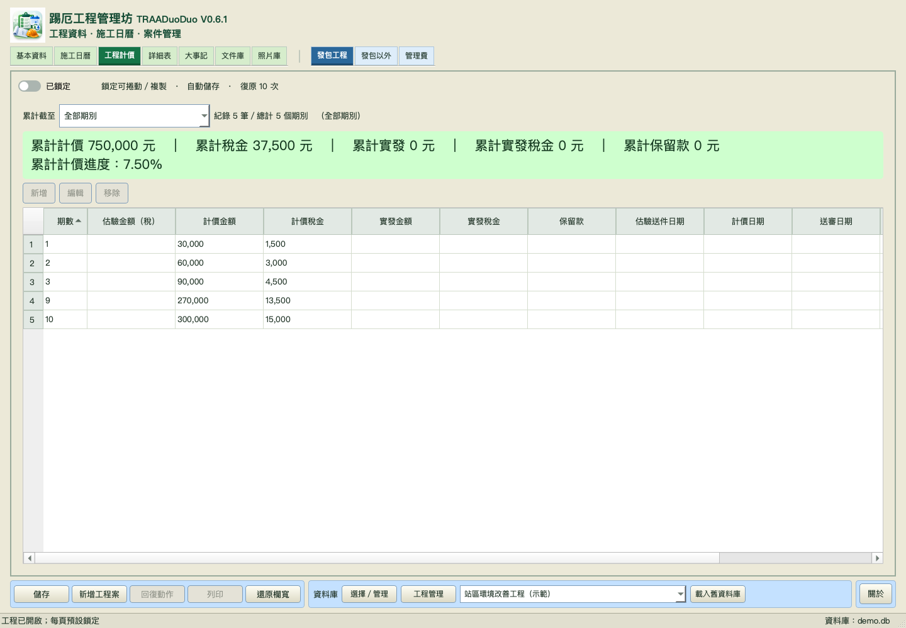

# 踢厄工程管理坊（TRAADuoDuo）

**目前版本：V0.6.1** · Python／PySide6 桌面工程管理程式 · GNU GPL v3

整合多工程基本資料、工程費用、保證金、施工日曆、工程計價及文件／照片庫，使用統一 SQLite 資料庫。舊版與原始來源保留，不自動覆寫舊資料庫。

## 最新版下載

- [完整 V0.6.1 原始碼 ZIP](deliverables/TRAADuoDuo_V0.6.1.zip) · [ZIP SHA-256](deliverables/SHA256.txt)
- [Python 啟動檔](TRAADuoDuo_V0.6.1.py) · [無主控台啟動檔](TRAADuoDuo_V0.6.1.pyw)
- [macOS 啟動器](start_macos.command) · [Windows 啟動器](start_windows.bat)
- [更新紀錄](CHANGELOG.md) · [V0.6.1 驗證說明](docs/V0.6.1_validation.md)

請下載完整 ZIP 或複製整個 repository；啟動檔需要同資料夾的 `traaduoduo/`、`assets/` 等資源，不是單檔獨立程式。本 repository 不含安裝包或 Windows EXE；此次沒有另建 GitHub Release 或標籤。

## 程式特色

- 多工程統一資料庫、頁面鎖定、自動儲存及復原；舊版／TR_FxWork 唯讀預覽後另庫匯入。
- 契約執行、工程費用、保證金及招標；Decimal 計算並保留來源精度。
- 施工曆整合假期、補班、鐵路疏運及晴雨；達契約工期後停止延續工期數字，日期與事件保留。
- 假期／補班／疏運同頁三表；費用緊湊欄高及行距，管理費兩位小數、保證金整數千分位。
- 期數依數字排序、截至所選期累計；發包進度為「（累計計價＋累計稅金）÷含稅契約金額」。
- AA 預算／招標／契約／變更詳細表、修訂版預覽、階層及欄位顯示；大事記日曆新增、行內編輯與自動行高。
- 文件／照片分類樹、連結或 Docstore 庫存、內容查重及跨工程共用；內容改變才加版本，不自動清除舊重複檔。
- PDF 連續閱讀、書籤及重點標記、可攜備份／另資料夾還原；表格及輸入欄可調寬並記憶。




## 安裝與執行

建議 Python 3.11 或更新版本。安裝相依套件後，從專案根目錄執行：

```sh
python3 -m pip install -r requirements.txt
python3 TRAADuoDuo_V0.6.1.py
```

macOS 可用 `start_macos.command`，Windows 可用 `start_windows.bat`。可指定 `--project PATH`。macOS 保留單一執行個體；舊版仍開啟時，請先自行儲存並正常退出，再啟動新版。

既有資料庫先備份，再用「載入舊資料庫」預覽並另建新庫。Docstore 與資料庫一起保存；僅有連結的文件不是已庫存備份，不要只搬移 .db 就假設包含所有附件。

## 檔案與版本歷史

- 根目錄是最新版程式、啟動器及必要文件；`traaduoduo/` 是共用模組。
- `deliverables/` 是公開原始碼 ZIP 與校驗碼，不重複收錄 `history/`。
- [歷史索引](history/README.md)：保留 [V0.0.1](history/V0.0.1/) 及 [V0.6.0](history/V0.6.0/)，不表示所有中間版本都曾公開。
- `docs/screenshots/v061/` 為本版實際 Qt 示範畫面；其他版本畫面及報告只作歷史參考。

公開版與本機／Drive 交付的業務程式碼一致；公開首頁、文件本機路徑及 ZIP 範圍另作整理，請勿混用公開 ZIP 與先前 Drive ZIP 的校驗碼。

## 建置與驗證限制

本版原始交付已通過 177 項回歸、47 個 Python 檔語法及 macOS Qt cocoa／offscreen 啟動關閉檢查；公開工作區另做回歸與封裝檢查。見 [驗證紀錄](docs/V0.6.1_validation.md) 與 [公開交付說明](docs/PUBLICATION.md)。

主要操作及畫面驗收為 Qt offscreen，不等同完整原生人工操作或所有 DPI 測試。Windows 實機／EXE、全部 HEIC／RAW／PDF 變體尚未驗證；未執行原生 Excel 重算。PsTOAA 技能包、列印及標示未開放功能不在本版範圍。

## 授權

本專案依 [GNU General Public License v3.0](LICENSE) 授權。
